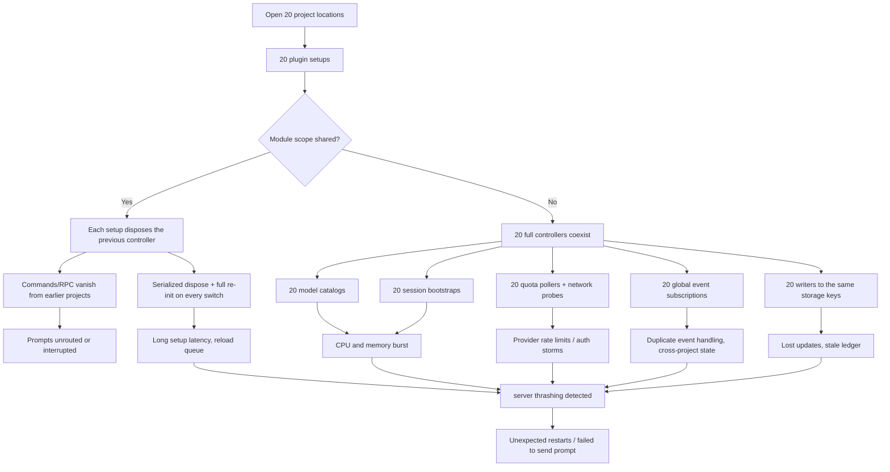
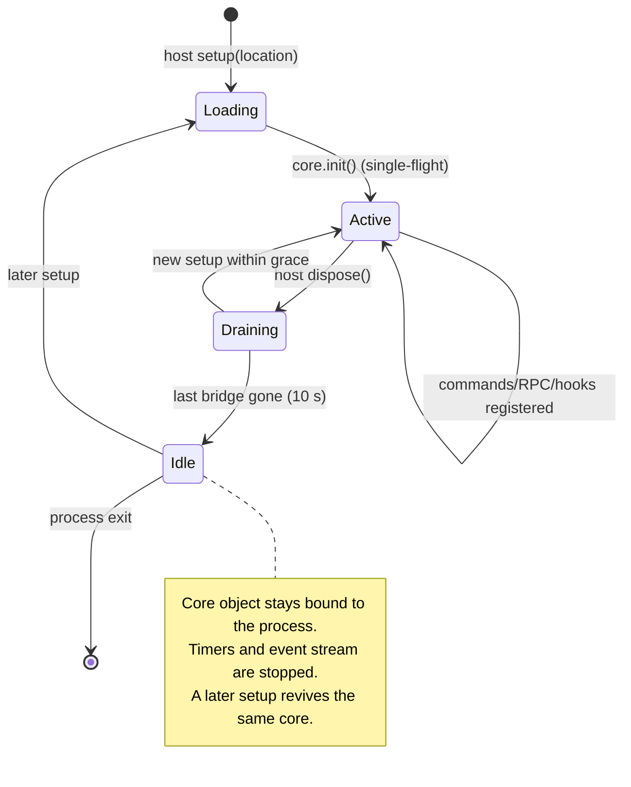

# 03 — Lifecycle root cause

This document reconstructs the production incident from the disabled bundle, the current source, and the isolated probes. It separates what is proven from what remains a hypothesis.

## 1. The host model (verified on OpenCode 2.1.4)

Three properties matter:

1. **A global plugin is loaded once per project location.** Opening 20 locations produced 20+ `setup` calls (133 during a churn test) in **one** server process (one PID).
2. **`globalThis` and plugin storage are process-wide.** All locations observed the same core id, and a value written by location 1 through `ctx.storage` was read by location 2.
3. **Commands and RPC are location-scoped.** Each location exposes its own command list; a command registered by one location is not visible in another.

A fourth property is **observed but not contractual**: module-level variables appear to be evaluated per location. If they were shared, the 21 simultaneous bridges observed in the lab would have collapsed to one as each setup disposed the previous module-level controller. They did not. The current code nonetheless still depends on this behavior; see §5.

## 2. What the disabled build did

The disabled artifact is a single bundled file:

`~/Documents/opencode-smart-router-disabled-20261027-160033/index.js`

### 2.1 Per-location heavy initialization

`index.js:3678-3710` (`RouterController.initialize`) ran, for every location:

```text
storage.get(ledger) + storage.get(runtime) + storage.get(quota)
ctx.model.list()                         // full model catalog
new QuotaService(...)                    // per-controller quota owner
registerRpc() / registerCommands() / registerHooks()
subscribeEvents()                        // one event stream per controller
bootstrapSessions()                      // ctx.session.list({ limit })
quota.initialize()                       // provider network probes
```

Only the last two were unawaited, but they still started immediately and ran per location. The model catalog was awaited before the user-facing surface was ready.

### 2.2 One controller, disposed on every setup

`index.js:4775-4782`:

```js
var active;
var lifecycle = Promise.resolve();
var index_default = Plugin.define({
  id: "opencode-smart-router",
  setup(ctx) {
    const next = lifecycle.then(async () => {
      if (active) await active.dispose();       // dispose the previous location
      const controller = new RouterController(...);
      active = controller;
      const cleanup = await controller.initialize();
      ...
```

When the module-level `active` is shared across locations, opening a second project destroys the first project's commands/RPC and re-runs the whole initialization. When it is not shared, every location keeps a full controller and the process does N times the work. The incident report records both symptoms: commands disappearing from the project in use, and a burst of per-location startup work.

### 2.3 Serialized disposal and persistence

`dispose` awaited the ledger write (`index.js:3655`), and the next setup awaited the previous dispose through the `lifecycle` promise. Rapid location changes therefore serialized:

```text
load location B
  → await dispose(location A)
      → write full ledger to shared storage
  → initialize location B
      → read the same three storage keys
      → model.list()
      → session.list()
      → quota probes
  → subscribe to a second global event stream
```

The storage keys (`ledger-v1`, `runtime-v1`, `quota-cache-v1`) were shared by every controller, so writes were last-writer-wins and could lose updates.

### 2.4 Duplicate global event streams

`index.js:4181` subscribed inside every controller:

```js
for await (const event of this.ctx.event.subscribe({ signal: this.abort.signal })) { ... }
```

The event stream is process-global. In the per-controller variant described in the incident report, every `session.model.selected`, step, and failure event was processed N times. In an isolated two-project lab this produced a false `MANUAL` state in one project when the other project's model changed — a direct cross-project correctness bug, not just extra work. The bundled singleton variant avoids N streams, but only by disposing the previous location's controller, which removes that project's commands and RPC.

## 3. How the failure multiplies



The incident report records approximately **420 plugin loads** and repeated `server thrashing detected` warnings in the debug bundle. That number is documented, not re-derived here. The mechanism that makes it plausible is the combination above: every location change re-enters a serialized, network-touching initialization while global events and storage are shared.

## 4. Proven vs hypothesis

| Claim | Status | Evidence |
|---|---|---|
| Plugin setup runs once per location in one process | **Proven** | 20-location probe: one PID, 133 setups, 21st counter |
| `globalThis` is shared across locations | **Proven** | All setups reported one core id |
| Plugin storage is process-global | **Proven** | Cross-location read of a written value |
| The disabled build initializes storage/catalog/session/quota per controller | **Proven** | Bundle lines 3678-3710 |
| The disabled build subscribes to events per controller | **Proven** | Bundle line 4181 |
| The disabled build disposes the module-level active controller on setup | **Proven** | Bundle lines 4775-4782 |
| Storage writes were last-writer-wins | **Proven by construction** | Shared keys, no merge protocol |
| Duplicate event handling caused cross-project MANUAL state | **Proven in a rebuilt lab** | Two-project lab before ownership guards |
| 420 loads were caused by this exact build | **Documented, not re-run** | Incident report / debug bundle |
| Server restarts were caused by memory exhaustion rather than the reload loop | **Unproven** | No post-mortem memory trace from the incident |
| Module scope is per location | **Strongly inferred** | 21 bridges, zero disposals in the shared-core lab |

The honest conclusion: the architecture made a reload storm and duplicate work inevitable under multi-project use. The precise trigger for the final restart is not proven, and does not need to be: removing the storm removes the class of failure.

## 5. Current repair status

The rebuilt source has already addressed most of the mechanism:

| Original problem | Current state | Reference |
|---|---|---|
| Per-location ledger/quota/persistence | One `SharedCore` per process | `src/server/shared-core.ts` |
| Concurrent init creating two ledgers/quota services | Single-flight `loading` promise | `shared-core.ts:114-129` |
| Per-location event streams | One stream in the core; dispatch to the owning bridge | `shared-core.ts:269-330` |
| Cross-project event handling | Session ownership + project/directory guard | `controller.ts:274-317`, `shared-core.ts:290-330` |
| Heavy model/session/quota work before commands | Commands/RPC/hooks first; bootstrap and quota delayed | `controller.ts:212-240` |
| Per-location quota polling | One `QuotaService` in the core | `shared-core.ts:131-230` |
| Last-writer-wins persistence | Single writer, snapshot before write, re-schedule on dirty | `shared-core.ts:380-420` |
| No cleanup | Bridge refcount, 10 s grace, core revival | `shared-core.ts:230-270`, `420-470` |
| Unbounded maps | Bounded ownership, sessions, maps | `controller.ts:278-330` |

But two lifecycle assumptions remain:

1. **`src/index.ts:10-24` still owns a module-level `active` controller.** It works only because module scope appears to be per location. The core already tracks bridges; the module-level controller is redundant and should be removed.
2. **`ctx.model.list()` is still called per bridge** (`controller.ts:237`). It is background and local, but it is N work on startup. The catalog could be cached in the core with a short TTL.

## 6. Bridge lifecycle (target)



The core never deletes its `globalThis` key. Deleting it allows a second core to be created while an old timer or write is still in flight; keeping an idle object is cheaper and safer.

## 7. How each candidate handles the same risks

| Risk | Ours | Marco | Sberdia | Sertdisk | Usage-limits |
|---|---|---|---|---|---|
| Per-location full init | Mostly removed; catalog still per bridge | Per-instance setup, but designed for it | Yes (catalog/build per instance) | Yes (catalog + web server) | TUI single lane |
| Duplicate global events | One stream + ownership | Per instance + claims/leases | Per instance; duplicate ledger records likely | Per instance; retry log duplicated | n/a |
| Duplicate quota polling | One service | No quota polling | No polling | No polling | One coordinator |
| Shared-state races | One core, single writer | Leases/claims on `globalThis` | JSON mtime sync, last-writer-wins | JSON state file | Effect fiber |
| Cleanup | Registrations + core grace | Extensive dispose barriers | No resources to clean | Disposers + server close | Fiber interrupt |
| Reload behavior | Core survives, bridge re-adds | Claims/sweep | Rebuild per instance | Rebind web server | TUI reload |

Marco is the only external project that treats multi-location lifecycle as a first-class design problem. Its solution (leases, claims, ownership, dispose barriers) is instructive, but it carries a large amount of machinery and a GPL license. Our core/bridge split is a smaller version of the same idea.

## 8. Lessons that constrain the redesign

1. **Nothing slow or network-bound may run in `setup`.** Register the minimum surface, then schedule work.
2. **One owner per resource.** One ledger, one quota coordinator, one event stream, one persistence writer.
3. **Never rely on module scope.** Use an explicit registry on `globalThis` with a versioned key, and make initialization single-flight.
4. **Every event needs an owner.** Process it once, in the project that admitted the session; ignore the rest.
5. **Disposal must be idempotent and bounded.** No unbounded awaits in the reload path; persist in the background with a final flush.
6. **Keep state bounded.** Ownership maps, session maps, decisions, and errors all need caps.
7. **Fail closed, including on exceptions.** A routing failure must block, not silently execute on an unqualified model.
8. **Prove the lifecycle with a 20-location soak, not with unit tests alone.**
