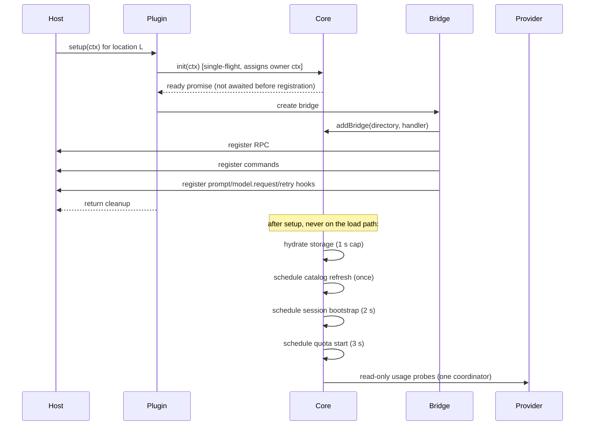

# 06 — Recommended design

**Status:** proposal for approval. Nothing in this document has been implemented during the audit.

## 1. Design principles

1. **One process, one core.** One routing core per OpenCode server process owns every shared resource: ledger, quota state, persistence, catalog cache, event subscription, diagnostics.
2. **One bridge per location.** A bridge is a thin adapter for location-scoped commands, RPC, and hooks. It owns no timers, no pollers, no network clients, and no persistence.
3. **Nothing slow on the load path.** `setup` registers the minimum surface and returns. Storage hydration, catalog refresh, session bootstrap, and quota probing happen after, or on first use.
4. **One writer, one stream, one scheduler.** No duplicate ledger writers, event subscriptions, or quota loops.
5. **Explicit ownership.** Every session has exactly one owning bridge. Events are dispatched once.
6. **Fail closed, including on exceptions.** An unqualified or unknown route must block, not silently execute.
7. **Bounded everything.** Sessions, ownership entries, decisions, errors, caches, and HTTP bodies.
8. **No unsupported host techniques.** No fake model/provider, no model-picker rewriting, no GUI injection.

## 2. Module boundaries

```text
src/
  index.ts                     plugin definition only; no module-level controller
  server/
    shared-core.ts             process core: lifecycle, ownership, persistence, events
    quota-coordinator.ts       one scheduler for Go + Command Code (new/split)
    controller.ts              per-location bridge: hooks, commands, RPC, titles
    diagnostics.ts             redacted, bounded diagnostics (optional split)
  core/
    classify/classifier.ts     deterministic task classification
    policy/eligibility.ts      hard requirements, premium policy, context fit
    routing/engine.ts          cost/quality ranking, cache loss, hysteresis
    quota/                     adapters + ledger + service (one owner)
    models/                    seed, registry, definitions
    config.ts                  validation, defaults, precedence
    failures.ts                failure taxonomy and retry policy
    ui.ts                      title indicator and notices
  rpc.ts                       typed RPC contract
```

The bridge may import the core; the core must not import the bridge. The core dispatches events through a narrow `BridgeHandler` interface:

```ts
interface BridgeHandler {
  readonly id: string
  readonly directory: string
  projectMatches(projectID?: string, directory?: string): boolean
  handleEvent(event: unknown): Promise<void>
}
```

## 3. Startup sequence



Rules:

- `init` must be idempotent and single-flight. A second location arriving during hydration joins the same promise (`shared-core.ts:114-129` already does this).
- The bridge does **not** await hydration before registering commands/RPC. The first prompt awaits `core.ready` with a bounded timeout (for example 1,000 ms); if storage is unavailable, routing proceeds with a warning and an empty ledger, and the failure is visible in diagnostics.
- The catalog refresh is **one** call in the core, cached with a short TTL. Bridges read the cached registry. Remove the per-bridge `ctx.model.list()` at `controller.ts:237`.
- No `session.list()` and no provider request before the first prompt or the delayed timers.

## 4. Resource ownership

| Resource | Owner | Count | Lifecycle |
|---|---|---|---|
| Ledger | Core | 1 | Hydrate once; single writer; bounded |
| Quota snapshots | Core | 1 per provider | Refresh coordinator; stale-aware |
| Quota scheduler | Core | 1 | Jittered timer; backoff; stopped on idle |
| Persistence timers | Core | 3 (ledger, runtime, quota) | Debounced; final flush on idle |
| Event subscription | Core | 1 | AbortController; restart on revive |
| Catalog cache | Core | 1 | TTL + background refresh |
| Session ownership map | Core | 1 | Bounded (2,000), release on delete |
| Commands / RPC | Bridge | 16 per location | Disposed with bridge |
| Prompt/retry/header hooks | Bridge | 3 per location | Disposed with bridge |
| Title queue | Bridge | 1 | Bounded; coalesced per session |
| Session-local maps | Bridge | 1 set | Bounded (500–2,000) |

## 5. Per-project lifecycle

### Setup

1. `core.init(ctx)` — single-flight.
2. `core.addBridge(directory, handler)` — returns a stable bridge id.
3. Register commands and RPC.
4. Register hooks.
5. Return an idempotent cleanup function.

### Dispose

1. Mark the bridge disposed (idempotent).
2. Dispose commands, RPC, and hooks.
3. `core.removeBridge(id)`.
4. Do **not** await ledger persistence in the dispose path. Schedule a flush; if the last bridge is gone, the core flushes during the grace period.
5. Release owned sessions.

### Last bridge / grace

- When the last bridge is removed, start a 10-second grace timer.
- If a new bridge arrives, cancel the timer.
- At expiry: stop the event stream, stop timers, flush storage, keep the core object bound to the process.
- A later setup revives it via `init` (started=false path). Never delete the `globalThis` key while timers or writes may still exist.

### Reload

- The host may call dispose and setup for the same location. The bridge id changes; the core and ledger do not.
- A rapid sequence of setups must not queue behind persistence. Persistence is asynchronous and coalesced.

## 6. Hook registration

### `session.hook("prompt")`

1. Read the session once (`ctx.session.get`).
2. Match by project id **or** directory containment (`controller.ts:274-317`). Directory matching is required when a location is opened at a subdirectory of a project.
3. Claim the session in the core.
4. If a routing call is already in flight for this session, return.
5. Call `routePromptSafely`.
6. On `RouterBlockedError`, rethrow so the host rejects admission.

### `session.hook("model.request")`

- Return unless this bridge owns the session (`core.ownerOf`).
- Add privacy/ZDR headers when configured.
- Never mutate the model here; the prompt hook has already done it.

### `session.hook("retry")`

- Return unless this bridge owns the session.
- Classify the failure.
- `auth`, `context_overflow`, `image_rejected`, `capability` → no retry.
- `rate_limit` → retry with `max(5 s, retryAfter)`.
- `provider_outage`, `network` → retry up to 3 attempts with backoff.
- `capacity` / `ttft_admission_refused` → treat as `provider_outage`, never escalate.

## 7. Fail-closed contract

Fail-closed must cover **every** path, not only a returned “no route” decision.

```text
routePromptSafely:
  try:
    decision = routePrompt(...)
    if runtime == automatic and failClosed and (no chosen or switch failed):
       if current model is unqualified:
          record blocked decision
          set BLOCKED title
          notify
          throw RouterBlockedError
    return decision
  catch RouterBlockedError:
    throw
  catch error:
    record blocked decision with the error reason
    set BLOCKED title
    notify
    if failClosed: throw RouterBlockedError
    else: record a warning and continue
```

Additional hardening:

- **Normalize every cost tier at config load.** `cache` defaults to `{ read: 0, write: 0 }`; `input`, `output`, `cache.read`, `cache.write` must be finite and ≥ 0; `context` and `maxOutput` must be > 0. Reject invalid definitions with a warning instead of accepting a shape the engine cannot price (`config.ts:210-211`).
- **Make `estimateTaskCost` defensive.** Use optional chaining and defaults even after validation (`engine.ts:113`). This is belt-and-braces, not a substitute for validation.
- **Never swallow a routing exception.** The current catch at `controller.ts:807-811` is the verified fail-open path.
- **Keep the blocked reason visible.** Title `BLOCKED · provider · model — base title`; decision error; notification.
- **Document the host limitation.** The rejection is an untyped HTTP 500; there is no polished rejection API. This is acceptable because it stops execution.

## 8. Quota refresh scheduling

One coordinator, two providers, independent due times.

| Setting | Proposed default | Notes |
|---|---|---|
| Base interval | 60 s | Same as usage-limits |
| Minimum | 30 s | Avoid accidental hammering |
| Jitter | ±10% | Prevent synchronized bursts |
| Request timeout | 8 s | Existing adapters use 8 s |
| Response cap | 256 KB | Our adapters; usage-limits uses 2 MB |
| Failure backoff | 2× up to 15 min | Per provider |
| Stale after | 2 intervals | Mark `stale: true`, retain last good |
| No credentials | Do not schedule | Surface a typed warning |
| Provider disabled | Do not schedule | Re-check on settings change |
| Read-only | GET only | Never billing mutations |

Semantics to adopt from usage-limits:

- keep the last successful snapshot and display it as stale on failure;
- distinguish missing credentials, timeout, transport, rate limit, and decode errors;
- respect `retry-after` when present;
- fetch providers concurrently, but never more than one in-flight request per provider;
- one scheduler per process, not per project.

The Go and Command Code endpoints remain best-effort and undocumented; the UI and routing must label provider data as `provider`, local estimates as `estimate`, and missing data as `unknown`.

## 9. Persistence and ledger

- **Single writer.** Only the core writes `ledger-v1`, `runtime-v1`, and `quota-cache-v1`.
- **Snapshot before write.** Serialize a snapshot, mark the ledger clean, write, then re-schedule if a mutation arrived during the write. This avoids the lost-update window in the current implementation.
- **Debounce.** 750 ms for ledger, 250 ms for runtime, 1 s for quota. Final flush on idle.
- **Schema version.** Include a version in each stored object; migrate or discard unknown versions with a warning.
- **Bounds.** 2,000 usage events, 120 decisions, 250 sessions, 40 days, 50 diagnostics errors.
- **No cross-process file sync.** If a future host isolates locations in separate processes, each process gets its own storage namespace and the design documents one core per process. Do not add a JSON file lock to solve a problem the host does not have.

## 10. Event handling

- One `ctx.event.subscribe` in the core.
- For every event with a session id:
  1. look up the owner;
  2. if no owner and the event is `session.created`, match by project id/directory and claim;
  3. if still no owner, ignore (do not call `session.get` for every event);
  4. dispatch once to the owning bridge.
- Maintain a short-lived negative cache (for example 30 s) for sessions known not to belong to any loaded location, to avoid repeated storage reads.
- On `session.deleted`, release ownership and clear per-session maps.
- On core idle, abort the subscription.

## 11. Titles, commands, RPC

- Keep the existing indicator states: `AUTO`, `MANUAL`, `PAUSED`, `DRY RUN`, plus `BLOCKED`.
- Titles remain per session, written by the owning bridge only.
- 16 commands per location; no global command registry.
- RPC remains location-scoped. `diagnostics` returns ids, directories, counts, and timestamps — never controller/context objects.
- Do not build a dashboard in this phase.

## 12. Safe shutdown

1. Stop accepting new bridges.
2. Dispose bridge registrations.
3. Abort the event stream.
4. Clear all timers.
5. Flush ledger, runtime, and quota snapshots.
6. Mark the core idle; keep it on `globalThis`.
7. On process exit, do not await network work.

## 13. Testing strategy

### Unit (fast, every change)

- Config normalization: cost tiers without `cache`, NaN/infinite values, duplicate keys, invalid tiers.
- Engine: no-throw for every model shape; cache-aware pricing; hysteresis; quota pressure.
- Fail-closed: exception, no route, switch failure, unqualified current model, opt-out.
- Classifier: trivial vs substantive, vision, design, context size.
- Eligibility: intelligence floor, design floor, vision, privacy, premium, purchased credits.
- Quota parsers: Go and Command Code fixtures, malformed payloads, stale/backoff, `retry-after`.
- Ledger: bounds, retention, lost-update handling, hydration warnings.

### Integration (mock host)

- Two bridges, one core, one event stream.
- Concurrent init (single-flight) — already covered by the new test.
- Cross-project event ownership.
- Directory-contained sessions with a different project id.
- Command presence per location.
- Manual override, pause, dry run, blocked title.

### Isolated server (the evidence that matters)

- 20 locations, concurrent prompts, commands from every project.
- Reload churn: dispose/setup cycles while prompts are in flight.
- Provider outage, auth failure, network refusal, rate limit.
- Large context session.
- Final artifact 30-minute soak: one core id, one PID, one event stream, zero thrash warnings, zero unexpected restarts, bounded RSS.
- Three cold starts with the same storage; verify title/manual state and commands.
- Canary: one project for 24–48 h before wider enablement.

### Acceptance thresholds

| Metric | Threshold |
|---|---|
| Duplicate cores in one process | 0 |
| Duplicate event streams | 0 |
| Duplicate quota schedulers | 0 |
| Leaked bridges after dispose | 0 |
| Commands per location | 16 |
| Prompts interrupted by plugin work | 0 |
| Server thrash warnings | 0 |
| Unhandled router exceptions | 0 |
| Fail-open on unqualified model | 0 |
| RSS growth over 30 min | bounded, no monotonic climb |

## 14. What to delete or simplify from the current code

| Item | Action | Reason |
|---|---|---|
| `src/index.ts:10-24` module-level `active` controller | **Delete** | Redundant with the core bridge registry; latent module-scope assumption |
| `controller.ts:237` per-bridge `ctx.model.list()` | **Move to core** | One catalog refresh per process |
| `controller.ts:220-227` fallback `new QuotaService(...)` | **Delete** | The core must always own the quota service; a fallback creates a second owner |
| Duplicate `compact`/`compactMode` runtime flags | **Collapse** | Two names for one setting |
| `docs/ARCHITECTURE.md` controller claims | **Rewrite** | Contradicts the bridge design |
| `docs/LIMITATIONS.md` “no prompt rejection” | **Rewrite** | Contradicted by the verified blocked-prompt behaviour |
| Controller diagnostics object exposure | **Already fixed** | Keep the redacted shape |
| Unused RPC/commands | **Audit and remove** | Reduce surface |

Target: a net reduction of 15–25% in source lines without losing behaviour.

## 15. Complexity and risks

**Relative effort:** medium. Roughly comparable to the completed rebuild, with less new functionality and more deletion/testing.

**Main risks**

1. **Host assumptions.** If module scope or `globalThis` sharing changes, the core must detect it. Mitigation: versioned `Symbol.for` key, diagnostics, and a startup self-check that refuses to create a second core in the same process.
2. **v2 hook semantics.** Prompt rejection is untyped. Mitigation: verified live behaviour, explicit documentation, and a test that asserts the hook throws.
3. **Quota endpoint drift.** Mitigation: read-only adapters, typed failures, stale data, and a visible `unknown` state.
4. **Over-engineering relapse.** Mitigation: the scope list in this document; no dashboard, no delegation framework, no web UI.
5. **Test theater.** Mitigation: the 20-location soak and cold starts are release gates, not optional.

## 16. Compatibility and fallback

- Primary target: OpenCode Desktop 2.1.4 / `@opencode/plugin` 2.1.4.
- If a future host removes `session.switchModel` or prompt hooks: fall back to the config-only option (Option E) for agent-level routing and document the loss of per-prompt guarantees.
- If a future host isolates locations in separate processes: one core per process is still correct; storage keys must include the process/workspace id, and the quota poller count becomes one per process. Document the change; do not attempt cross-process shared memory.
